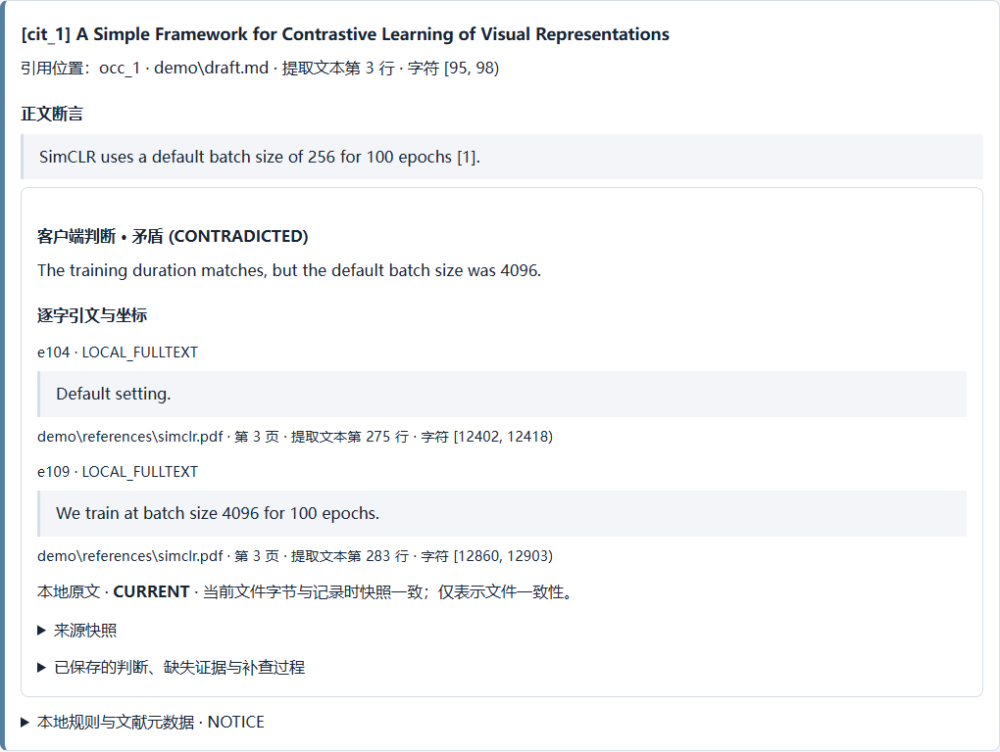

# Academic Guardrail Agent

English | [中文](README_CN.md)

Give your MCP client a Word or Markdown draft with numbered citations and a folder of reference papers. Academic Guardrail ties each citation to its paper, checks the client's quotes against the source text and puts the judgments, source locations and unresolved citations in one HTML report. A Python CLI also provides metadata, retraction and rule-based checks.

## Check a citation against the paper

Our example draft says SimCLR used a default batch size of **256** for **100 epochs**. Page 3 gives **4096** for the batch size and confirms the training duration. The same paper is cited correctly elsewhere in the draft. The report keeps both occurrences so the author can fix the wrong number. This is an authored example based on a real paper. [SimCLR, page 3](https://arxiv.org/pdf/2002.05709v3#page=3) · [Example manuscript](docs/examples/manuscript_review.md)

The draft separately cites a paper with a confirmed retraction. Its row shows the retraction even without a local PDF. The bundled offline database has three historical examples. [Publisher's retraction notice](https://doi.org/10.1038/nature13598)



After installing from source, run the offline example below. It replays explicit example judgments through the MCP interface and writes the reports locally. For your own draft, use the `review_manuscript_workflow` prompt in your MCP client. [Using the manuscript workflow](docs/manuscript_review_guide.md)

```bash
python -m scripts.validate_manuscript_review --output scratch/manuscript_demo
```

Open `scratch/manuscript_demo/md/report.html` or `scratch/manuscript_demo/docx/report.html`. To review your own draft, give the client the paths to the draft, your references folder and a new HTML file. For example:

> Review every numbered citation in draft.docx against the papers in references/. Use the full text. Save each judgment with the exact quote and its location. Include missing sources and retractions. Export everything to draft_review.html.

The [90-case offline retrieval regression](docs/manuscript_retrieval_results.md) reports recovered evidence, previously available evidence that dropped out and the amount of text returned.

## Install from source

Python 3.10+ and the official MCP Python SDK 2.3+ (below 3) are required. In a dedicated environment, from this repository:

```bash
python -m pip install --upgrade -e ".[dev]"
academic-guardrail verify "10.1038/nature12968" --offline
academic-guardrail audit docs/examples/sample_manuscript.md --offline -o report.html
```

The distribution name is `mcp-academic-guardrail`; the executable is `academic-guardrail`. Source installation does not assume a public PyPI release.

See the [SDK migration and CI guide](docs/mcp_sdk_migration_guide.md) for SDK 2.x changes, real stdio checks and clean-environment reproduction.

## Online and offline operation

Default operation queries OpenAlex, Crossref and/or Semantic Scholar. Supplying `--refs-dir` adds local references but does not disable online queries.

```bash
academic-guardrail audit manuscript.docx --refs-dir references -o report.html
academic-guardrail audit manuscript.docx --refs-dir references --offline -o report.html
academic-guardrail verify "Attention Is All You Need" --detail detailed
```

`--offline` skips online provider construction and embedding model initialization/download. It consults the local retraction database and supplied reference files only. HTML reports use inline CSS/JavaScript and system fonts; opening/filtering them requires no CDN. Following a DOI link still opens an external website.

The bundled retraction database contains **three historical examples**, not the full Retraction Watch database. `RETRACTION_DB_PATH` may point to a local SQLite database with the same schema. No complete database download/synchronization is implemented. An unknown DOI remains unverified offline.

Optional `python -m pip install -e ".[full]"` enables sentence-transformers. In online mode, first use may download a model. Otherwise lexical rules are used. Both approaches provide review hints rather than entailment proofs.

## Result contract

| Field | Meaning |
| --- | --- |
| `status` | Reference/claim outcome: valid, unverified, retracted or mismatch |
| `risk_level` | Alert level within the check's scope |
| `evidence_status` | Online/local match, ambiguity, unavailable provider or other acquisition state |
| `retraction_status` | `CONFIRMED`, `SUSPECTED`, `NO_RECORD`, `NOT_CHECKED` |
| `sources` | Source, kind, identifier, description and source retraction flag |
| `verification_scope` | `REFERENCE_METADATA`, `TEXT_RETRIEVAL` or `RULE_BASED_REVIEW` |
| `alignment_state` | `TEXT_ALIGNED`, `POTENTIAL_CONFLICT`, `REVIEW_REQUIRED`, `INSUFFICIENT_EVIDENCE` |
| `semantic_findings` | Rule code, explanation, exact claim/evidence text, source and available coordinates |
| `claim_alignment_score` | Retrieval similarity, never a truth probability |

Identity is resolved before retraction facts are assigned to a citation. An ambiguous candidate does not establish that the cited paper is retracted. Title keywords are only suspected signals. Explicit retraction evidence for the same DOI is retained when merging providers.

`PASS` is limited to metadata checks. Claim checks receive at least `NOTICE`, including `TEXT_ALIGNED`; wording agreement does not establish scientific correctness. `NO_RECORD` is limited to consulted sources, never an assertion of normal status. Failures are kept distinct from empty results. Local matching uses extracted metadata; a title appearing in another paper's bibliography is not identity evidence.

## MCP

One MCP server exposes twelve tools and two workflow prompts.

| Tool | Purpose |
| --- | --- |
| `verify_single_citation` | Check one reference's identity, metadata and retraction evidence |
| `check_paper_retraction` | Query retraction evidence by DOI, reusing single-reference verification |
| `audit_document_claims` | Audit a document, return findings and save an HTML report |
| `generate_audit_html_report` | A convenience entry point whose main output is the HTML report |
| `prepare_claim_review` | Resolve a reference or accept supplied text; save an evidence packet for the client |
| `read_claim_evidence` | Read remaining evidence pages from the same saved snapshot |
| `record_claim_review` | Check snapshot digest, evidence IDs and exact quotes; save the client's judgment |
| `prepare_local_claim_review` | Match one local paper and freeze its real abstract or full text |
| `follow_up_local_claim` | Search that same paper once for a gap recorded by the client; preserve earlier evidence |
| `generate_claim_review_report` | Export selected saved judgments and their before/after evidence to HTML |
| `prepare_manuscript_review` | Bind each occurrence in a Markdown or Word draft to its local source and evidence packet |
| `generate_manuscript_review_report` | Combine the draft, saved judgments, exact quotes and unresolved occurrences in one HTML report |

Configure an MCP client to launch the installed executable:

```json
{"mcpServers": {"academic-guardrail": {"command": "academic-guardrail-mcp"}}}
```

The manuscript workflow defaults to offline source retrieval. The client's model runs wherever you configured it. The CLI and the standard document audit provide rule-based checks. In an MCP client, `audit_document_claims` with `client_review: true` starts the manuscript review queue. Set `offline: true` on this entry point for local sources only.

Use the `review_claim_workflow` prompt or ask the client to prepare evidence, read every page, compare subject/relation/numbers/scope/counterevidence, and record its conclusion. Pass the returned `packet_sha256` as `expected_packet_sha256` when recording. A local `REVIEW_REQUIRED` result is a hint for the client to continue, not a final handoff to the user. See the [client workflow and code guide](docs/client_review_guide.md).

For a local paper the client can record a missing fact, search that paper once, then reconsider the claim with both sets of evidence. The HTML shows the query, quotes, locations and file status. See the [local follow-up guide](docs/local_followup_guide.md).

Client conclusions are `SUPPORTED`, `CONTRADICTED`, `NOT_ENOUGH_EVIDENCE` or `UNCERTAIN`. `EVIDENCE_LINKS_VALID` describes the quote and ID checks. In manuscript mode the report shows each saved conclusion alongside the source text and the original draft location.

## Read and test

See the [Chinese code reading guide](docs/learning_guide.md) and [phase-one design](docs/plans/phase_one.md).

The [phase-two guide](docs/phase_two_guide.md) explains separate bibliography entries and body occurrences, source coordinates, and format boundaries. Repeated citations share one metadata lookup but retain separate results. Reports distinguish reference counts, occurrence counts (one per cited key), result rows, parsing diagnostics and text retrieval status.

```bash
academic-guardrail audit docs/examples/phase_two_manuscript.md --refs-dir docs/examples/phase_two_refs --offline -o phase_two_report.html
```

This synthetic fixture has one bibliography entry and three occurrences, including an unresolved `[2]`. Local evidence is retrieved from body passages with file/page/character positions. Abstract and full-text sources remain explicit.

```bash
python -m pytest tests -q
```

Tests isolate caches, block real HTTP and disable embedding models. They validate software behavior, not live provider availability or LLM benchmark accuracy.

Phase four provides a [reproducible evaluation workflow](benchmarks/README.md) and [Chinese evaluation guide](docs/phase_four_guide.md). Inputs, gold labels and predictions are separate; runs record data/code hashes and support scoring replay. All cited SciFact pairs are retained for native-state, conflict-alert and excerpt diagnostics. Development regressions are reported separately. Original scripts are archived under `benchmarks/legacy/`; historical LLM accuracy remains unverified.

The [semantic coverage follow-up](docs/semantic_coverage_results.md) reports the unresolved rule-only result and a small actual client/MCP pilot separately. Neither insufficient evidence nor a valid quote is counted as successful support/refutation. The pilot is not a general accuracy claim or a comparison against a bare model.

The [expanded client evaluation](docs/client_evaluation_results.md) adds 60 public-train cases in separate discovery/validation partitions and explicitly records the interactive Codex client. It reports remaining errors rather than claiming a verified accuracy gain. Optional source-linked revision suggestions help draft narrower statements without changing the original claim's verdict.

The latest [same-evidence comparison](docs/paired_review_results.md) uses 30 new cases and 90 independent Codex CLI judgments, requesting `gpt-6.1-sol` with high reasoning. Direct / guided direct / MCP agree with the official labels on 22/30, 21/30 and 21/30 cases; contradiction recall is 9/10, 8/10 and 8/10. This small experiment does **not** demonstrate a semantic gain from MCP. The [reading and reproduction guide](docs/paired_review_guide.md) explains optional claim-part findings, the three controls and preserved raw evidence. The subsequent v2 protocol clarifies a common storage contract; its model performance is unmeasured.

The subsequent [local follow-up evaluation](docs/local_followup_results.md) uses 15 authored claims from five real papers (9 development, 6 validation) and 45 independent client calls. Both local follow-up and direct reading of the parsed main text agree with the frozen reference labels on 15/15 cases: 10 correct concrete judgments and 5 remaining insufficient-evidence results, with no false concrete verdicts. Follow-up uses 28.08% fewer input tokens, including the shared initial judgment. This small, targeted sample shows a context reduction, not a semantic accuracy gain or a general 100% accuracy claim. Parsed text stops before References and omits later appendices. The [evaluation guide](docs/local_followup_evaluation_guide.md) explains the shared budget, frozen evidence and reproduction boundaries.

The [expanded 90-case evaluation](docs/expanded_local_followup_results.md) uses 15 different, version-pinned papers and `gpt-6.1-terra` / `max`, adding an independent **single-call full-text control**. Local follow-up uses 26.11% fewer input tokens and 19.48% fewer output tokens, but its raw contradiction recall is **40/45 versus 45/45**, with 22 NEI and one uncertain result. It produces 67 correct concrete answers, of which 66 pass output validation, versus 75 for full text. On the separate 60-case validation set, raw contradiction recall is 27/30 versus 30/30. This is a measured completeness/cost tradeoff, not an accuracy improvement. Reasoning output rises 29.15% against the single-call control. All 332 completed-study calls and eight calls from an aborted initial round remain in the 340-call expenditure ledger. Claims are source-grounded and authored, not natural user requests or human-expert gold; native autonomous MCP-client overhead and multi-claim batching are unmeasured.

The [phase-three guide](docs/phase_three_guide.md) explains the separate numeric, negation, causal and scope rules. Each finding retains its triggering evidence. Run the synthetic four-category example or replay the real offline CLI/MCP interfaces:

```bash
academic-guardrail audit docs/examples/phase_three_manuscript.md --refs-dir docs/examples/phase_three_refs --offline -o phase_three_report.html
python scripts/validate_phase_three.py --output-dir phase_three_validation
```

The old five-element `evaluate_alignment()` tuple remains callable, but its state labels now use the review vocabulary above. New Python callers should use `assess()` or `assess_passages()` and named fields. Historical benchmark label mappings require migration before use.

## Limitations

Parsing covers common numbered references, repeated/grouped citations, literal BibTeX fields and common LaTeX citation commands. It does not expand arbitrary TeX macros, cover every author-year style or perform OCR. DOCX extraction covers body paragraphs and tables; complex PDF layout and cross-page sentence order remain limited. Local metadata extraction is heuristic. Matching scores are not calibrated probabilities. Bounded wording checks flag explicit quantities, negation and qualifiers; complex semantics need the client model's analysis, which can still be wrong. Missing sources and unresolved ambiguity need additional evidence or human input. Online and local retraction coverage may be incomplete or stale. No scientific truth or benchmark accuracy claim follows from the regression tests.
