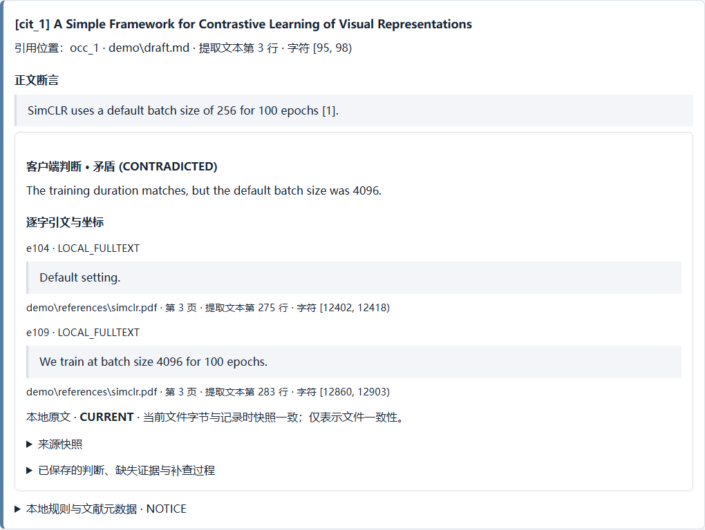

# Academic Guardrail Agent

[English](README.md) | 中文

把使用编号引用的 Word 或 Markdown 初稿和参考文献目录交给已有的 MCP 客户端。Academic Guardrail 将稿件里每一处引用对应到文献，逐字核对客户端给出的引文，并把判断、原文位置和未解决的引用汇入同一份 HTML 报告。Python 命令行也可用于核验文献元数据、查询撤稿和运行规则检查。

## 一个引用写错了，怎样找到原文？

示例初稿写道，SimCLR 默认用 **256** 的批量训练 **100 轮**。论文第 3 页给出的默认批量是 **4096**，训练轮数确实是 100。稿子另一处正确引用了同一篇论文，报告分别保留这两处判断，作者可以直接回到写错数字的那一句。这是依据真实论文编写的错引示例。[论文第 3 页](https://arxiv.org/pdf/2002.05709v3#page=3) · [示例初稿](docs/examples/manuscript_review.md)

稿中还单独引用了一篇已确认撤稿的文献。即使本地没有它的 PDF，该行仍显示撤稿状态。离线内置库收录三个历史示例。[出版方撤稿通知](https://doi.org/10.1038/nature13598)



按下文从源码安装后，用下面的命令回放示例判断并生成整稿报告。审自己的稿件时，在 MCP 客户端使用 `review_manuscript_workflow` 工作流。[整稿使用与代码导读](docs/manuscript_review_guide.md)

```powershell
python -m scripts.validate_manuscript_review --output scratch/manuscript_demo
```

打开 `scratch/manuscript_demo/md/report.html` 或 `scratch/manuscript_demo/docx/report.html`。换成自己的稿件时，把初稿、参考文献目录和一个新的 HTML 输出路径告诉客户端，例如：

> 用 Academic Guardrail 审查 draft.docx 里每一处编号引用，逐篇读取 references 里的论文全文。把每处判断、逐字引文和原文位置放在一起，保留缺原文和已撤稿的条目，导出到 draft_review.html。

[90 条样本离线回归](docs/manuscript_retrieval_results.md) 列出了哪些证据被找回、哪些旧证据丢失，以及每种方法需要返回多少原文。

## 安装与运行

要求 Python 3.10 或以上，使用官方 MCP Python SDK 2.3+（低于 3）。建议在独立环境中从本仓库安装：

```powershell
python -m pip install --upgrade -e ".[dev]"
academic-guardrail verify "10.1038/nature12968" --offline
academic-guardrail audit docs/examples/sample_manuscript.md --offline -o report.html
```

项目的发行包名是 `mcp-academic-guardrail`，CLI 命令名是 `academic-guardrail`。上面的源码安装不依赖同名 PyPI 项目是否已发布。

SDK 2.x 的接口变化、真实 stdio 检查和干净环境复现见 [MCP SDK 迁移与 CI 指南](docs/mcp_sdk_migration_guide.md)。

## 在线与离线

默认模式会查询 OpenAlex、Crossref 和/或 Semantic Scholar。`--refs-dir` 仅提供本地参考文件，并不会自动关闭在线查询。

```powershell
# 在线查询，并可用本地参考文件补充文本
academic-guardrail audit manuscript.docx --refs-dir references -o report.html

# 严格离线：只用本地撤稿数据库和参考文件
academic-guardrail audit manuscript.docx --refs-dir references --offline -o report.html

# 单条文献元数据查询；不做正文断言核验
academic-guardrail verify "Attention Is All You Need" --detail detailed
```

离线模式不创建在线数据源客户端，不加载或下载嵌入模型。HTML 报告的 CSS 和 JavaScript 全部内联，可离线打开、搜索和筛选；点击 DOI 链接仍会打开外部网站。

内置撤稿库只有 **3 条历史示例**，不代表完整 Retraction Watch 数据库。`RETRACTION_DB_PATH` 可以指向同结构的本地 SQLite 数据库；项目当前没有完整数据库的自动下载与同步功能。离线查不到 DOI 时返回 `UNVERIFIED`，不能据此判定论文未撤稿。

可选 `python -m pip install -e ".[full]"` 启用 sentence-transformers。在非离线模式下，首次使用可能下载模型；无此依赖时使用词面规则。两种方式都只提供比对线索。

## 读懂结果

| 字段 | 含义 |
| --- | --- |
| `status` | 当前结果：匹配、未核实、撤稿或文本不匹配 |
| `risk_level` | 本次检查的提示等级，不是科学正确率 |
| `evidence_status` | 匹配到在线文章、本地文件、歧义、查询失败等原因 |
| `retraction_status` | `CONFIRMED` / `SUSPECTED` / `NO_RECORD` / `NOT_CHECKED` |
| `sources` | 数据源、证据类型、标识符、说明及来源自身的撤稿标记 |
| `verification_scope` | `REFERENCE_METADATA`、`TEXT_RETRIEVAL` 或 `RULE_BASED_REVIEW` |
| `alignment_state` | `TEXT_ALIGNED`、`POTENTIAL_CONFLICT`、`REVIEW_REQUIRED`、`INSUFFICIENT_EVIDENCE` |
| `semantic_findings` | 规则代码、解释、触发断言、证据原文、来源和可用坐标 |
| `claim_alignment_score` | 检索相似度，不是真实性概率 |
| `retrieval_status` | 文本可用、无文本、低相关性或本地歧义；与文献身份状态分开 |
| `text_source` / `evidence_location` | 在线摘要、本地摘要或全文；本地摘录保留文件、页码（适用时）和字符位置 |

先确认文献身份，再归属撤稿证据。歧义候选即使带撤稿标记，也不能直接说用户引用的是撤稿论文。标题中出现 “retraction” 只作为疑似线索；同 DOI 的明确撤稿证据不会被另一来源的否定标记覆盖。

`PASS` 仅用于元数据核查；正文规则检查至少标为 `NOTICE`，`TEXT_ALIGNED` 也不等于语义已经核验。客户端应继续结合原文分析。`NO_RECORD` 仅表示查询过的来源没有记录，不能解释成“状态正常”。查询超时、限流与无结果分开保留。本地文件通过标题等元数据匹配；另一论文参考文献列表中出现标题，不构成匹配依据。

## MCP 使用

项目提供**一个 MCP 服务**，包含十二个工具和两个工作流提示。

| 工具 | 用途 |
| --- | --- |
| `verify_single_citation` | 核验单条文献的身份、元数据和撤稿线索 |
| `check_paper_retraction` | 用 DOI 查询撤稿证据，内部复用单条文献核验 |
| `audit_document_claims` | 审核文档引用及正文，返回核查说明并保存 HTML 报告 |
| `generate_audit_html_report` | 以生成 HTML 报告为主要输出的便捷入口 |
| `prepare_claim_review` | 解析文献或接收原文，保存供客户端判断的证据包 |
| `read_claim_evidence` | 按页继续读取同一证据快照 |
| `record_claim_review` | 校验快照摘要、证据编号和逐字引用，保存客户端判断 |
| `prepare_local_claim_review` | 匹配一份本地论文，保存真实摘要或全文证据 |
| `follow_up_local_claim` | 根据已记录的缺口，在同一篇论文中定向补查一次，保留原证据 |
| `generate_claim_review_report` | 将选定判断及补查前后的证据导出为 HTML |
| `prepare_manuscript_review` | 为 Markdown 或 Word 初稿中每处引用绑定本地文献和证据包 |
| `generate_manuscript_review_report` | 在同一份 HTML 中展示初稿、客户端判断、逐字引文和未解决的引用 |

MCP 客户端可以启动源码安装后生成的命令：

```json
{
  "mcpServers": {
    "academic-guardrail": {
      "command": "academic-guardrail-mcp"
    }
  }
}
```

整稿工作流默认离线取证，客户端使用你配置的模型。CLI 和普通文档审计提供规则检查。在 MCP 客户端把 `audit_document_claims` 的 `client_review` 设为 `true` 就能开始整稿语义审查，同时设置 `offline: true` 可限定服务端只用本地来源。

使用 `review_claim_workflow` 提示，或让客户端依次完成“准备证据 → 读取全部分页 → 检查主体、关系、数字、范围和反证 → 记录结论”。记录时将准备结果的 `packet_sha256` 传为 `expected_packet_sha256`。规则返回复核或证据不足时，客户端应继续分析可用原文。完整示例和源码阅读顺序见[客户端判断导读](docs/client_review_guide.md)。

对于本地论文，现在可以继续完成“说明具体缺口 → 在同一原文件中补查一次 → 结合新旧证据再判断 → 展示前后结果”。报告保留原判断、检索词、逐字引文、位置和文件状态；来源变化会阻止保存新判断，仍未解决的缺口会明确显示。三个新工具只处理本地文件，不调用模型 API。可运行示例和阅读顺序见[本地补查导读](docs/local_followup_guide.md)。

客户端给出 `SUPPORTED`、`CONTRADICTED`、`NOT_ENOUGH_EVIDENCE` 或 `UNCERTAIN`。`EVIDENCE_LINKS_VALID` 表示引文和编号通过了校验。整稿报告将保存的语义判断、原文引文和稿件位置放在同一条引用下。

## 学习与验证

推荐先读 [第一阶段代码导读](docs/learning_guide.md)，按“数据模型 → 纯判定函数 → 服务层 → 接口”顺序阅读，再运行相应回归测试。

[第二阶段代码导读](docs/phase_two_guide.md) 解释文献条目与每处正文引用的区别、全文证据位置以及格式支持范围。可运行合成样例：

```powershell
academic-guardrail audit docs/examples/phase_two_manuscript.md --refs-dir docs/examples/phase_two_refs --offline -o phase_two_report.html
```

样例有 1 个文献条目、3 次正文引用；其中 `[2]` 缺少条目，会显示解析提示。报告的风险计数按结果行统计，不等于不同论文的数量。

```powershell
python -m pytest tests -q
```

测试默认隔离缓存、阻止真实 HTTP、关闭嵌入模型，验证的是工程行为，不是线上 API 可用性或 LLM 的学术推理准确率。

第四阶段提供 [可复现评测流程](benchmarks/README.md) 和 [中文评测导读](docs/phase_four_guide.md)。输入、答案与预测分开保存，每次运行记录代码/数据哈希并可独立重算指标。SciFact 使用全部所引文献配对，报告原生状态、冲突告警和证据摘录诊断；开发回归单独报告。历史脚本已原样归档到 `benchmarks/legacy/`，历史 LLM 准确率仍不作为本版本的已验证能力。

[语义覆盖整改实测](docs/semantic_coverage_results.md) 分开报告规则仍全部未解决的结果和小批实际客户端试跑。证据不足、引用校验成功都不计为成功支持或反驳；小批结果不能写成项目的通用准确率。

[扩大样本后的实测](docs/client_evaluation_results.md) 新增 60 条公开 train 样本，分开发现组和后续验证组，并明确由当前 Codex 助手判断。结果保留错误，没有证明语义准确率提升；新增可引用的改写建议帮助缩小表述范围，原论断结论仍单独计分。

最新[同证据直接模型对照](docs/paired_review_results.md) 使用 30 条新样本、90 次独立 Codex CLI 判断，请求 `gpt-6.1-sol`、推理 `high`。直接模型 / 加语义提示 / 加 MCP 的标签一致率分别为 22/30、21/30、21/30，反驳召回分别为 9/10、8/10、8/10。**这批小样本没有证明 MCP 带来语义增益。** [阅读与复现导读](docs/paired_review_guide.md) 说明可选的论断分项分析、三组对照和原始证据保存。后续 v2 仅补全三组共同的记录规则，尚未测量模型效果。

[本地补查实测](docs/local_followup_results.md) 随后使用五篇真实论文的 15 条编制论断（开发 9、验证 6），完成 45 次独立客户端调用。补查与直接读已解析正文均为 15/15 标签一致：10 条正确明确判断、5 条保留证据不足、零错误明确判断。包含共同初判后，补查路径的输入 token 少 28.08%。这批定向小样本测到的是上下文减少，没有测到语义准确率优势，也不能称为通用准确率 100%。当前正文止于 References，不含后续附录；[评测导读](docs/local_followup_evaluation_guide.md) 说明共同预算、冻结证据和复现边界。

[第三阶段代码导读](docs/phase_three_guide.md) 解释数字、否定、因果、范围规则及其人工复核边界。四类问题的合成演示与实际入口验收：

```powershell
academic-guardrail audit docs/examples/phase_three_manuscript.md --refs-dir docs/examples/phase_three_refs --offline -o phase_three_report.html
python scripts/validate_phase_three.py --output-dir phase_three_validation
```

旧 `evaluate_alignment()` 五元素元组结构保留，状态标签已改为上表中的复核词汇。新代码建议调用 `assess()` / `assess_passages()` 读取命名字段；历史评测的标签映射需要单独迁移。

## 当前局限

- 解析器覆盖常见编号引用、重复/分组引用、字面量 BibTeX 和常见 LaTeX 关联；不执行任意宏，不支持所有作者年份制格式。Word 覆盖正文和表格；PDF 不做 OCR，复杂排版仍可能丢失或错序。
- 本地标题、作者、年份来自简易抽取；匹配分数不是校准后的概率，歧义时需要补全信息。
- 新增规则可以提示明确的数值、否定和限定差异；复杂语法、单位、同义改写、跨句语境和跨语言仍可能遗漏或过度提示，不构成真实蕴含判断。
- 在线来源可能缺摘要、延迟索引或不可用；撤稿数据库也可能不完整或过期。

这些限制应在演示和简历介绍时明确。可以描述已实现的多源查询、来源保留、统一判定、离线模式和回归测试，不宜宣称“自动保证论文正确”或未经复现的准确率。
